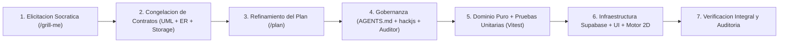

# 01. Metodología de Desarrollo: Design-First, Prompting y Refinamiento Iterativo

## 1. ¿Qué es la Metodología Design-First y por qué se eligió?

**Design-First** es una metodología de ingeniería de software en la que los **contratos de datos, arquitectura de capas, diagramas UML, esquemas de base de datos, políticas de seguridad y protocolos de red** se definen, discuten y aprueban *antes* de escribir la primera línea de código de aplicación.

En **Frank and Bang** resultó indispensable por tres razones concretas:
1. **Modularidad extrema solicitada:** El juego debe permitir agregar nuevas piezas (`Normal`, `Rara`, `Única`) y nuevos archivos visuales (`.svg` o `.png`) directamente en Supabase sin modificar el código fuente. Sin congelar primero el esquema `public.parts_catalog` y el contrato del bucket `parts-assets`, la interfaz habría quedado acoplada a listas hardcodeadas.
2. **Sincronización multijugador Host-Autoritativo:** Antes de programar el Canvas 2D o Supabase Realtime, era necesario diseñar el diagrama de secuencia y el contrato de mensajes (`input_cmd` del invitado vs `state_snapshot` del host) para evitar desincronización de cráteres y daño entre computadoras.
3. **Dirección humana sobre la IA (criterio de rúbrica):** Design-First convierte al estudiante en el arquitecto que valida cada decisión antes de generar código, evitando soluciones improvisadas o sobre-ingeniería típica de generación sin dirección.

---

## 2. Aplicación Paso a Paso en Frank and Bang

1. **Elicitación Socrática (`/grill-me`):** Antes de proponer código, se recorrió el árbol de decisiones una pregunta a la vez (stack 100% web Next.js, topología Host-Autoritativo sobre Supabase Realtime, economía del Gacha, conversión de `hackthon` a `hackjs`, flujo de Auth y autoría del equipo).
2. **Diseño de Contratos y Diagramas:** Se redactó `implementation_plan.md` con Diagrama de Capas, Diagrama de Clases UML, Diagrama Entidad-Relación con RLS y Diagramas de Secuencia.
3. **Refinamiento Iterativo del Diseño (antes de codificar):**
   - *Iteración 1:* Se reemplazó un catálogo JSON inicial por almacenamiento 100% en Supabase (`public.parts_catalog`), se reenfocó el agente auditor a dicha tabla y se instauró la regla obligatoria de sesiones en `AGENTS.md`.
   - *Iteración 2:* Se añadió el bucket público de Supabase Storage **`parts-assets`** para servir de forma unificada los archivos `.svg`/`.png` tanto de las partes del cuerpo como de las tarjetas del Gacha, resolviendo propiedad en `user_inventory` y URL visual desde el bucket.
4. **Implementación guiada por contratos:** Solo tras la aprobación explícita del plan se procedió a construir `hackjs`, la migración SQL, los SVGs de `anatomy`, el dominio puro con pruebas en Vitest, las rutas de Next.js y el motor 2D.

---

## 3. Técnicas de Prompting Aplicadas (Evidencia para Rúbrica)

| Técnica de Prompting | Dónde se aplicó | Resultado obtenido |
|---|---|---|
| **Design-First / Spec-Driven Prompting** (`/plan`) | Creación y validación de `implementation_plan.md` | Congeló arquitectura, UML, RLS y contratos antes de crear cualquier archivo de código. |
| **Prompting Socrático / Árbol de Decisiones** (`/grill-me`) | 6 preguntas secuenciales dependientes | Eliminó ambigüedades críticas (stack web, Host-Realtime, economía TCG, autor `Jonathan Serna`). |
| **Prompting por Restricciones mediante Skills** (`hackjs`, `supabase`, `anatomy`) | Generación de código JS/TS, SQL y SVGs | Garantizó código limpio para estudiantes, JSDoc en inglés, RLS estricto e ilustraciones isométricas consistentes. |
| **Prompting Basado en Roles (Persona)** (`design-balance-auditor`) | Agente personalizado en `.agents/agents/` | Separa el rol de implementación del rol crítico de auditoría de balance en `public.parts_catalog` y seguridad. |

---

## 4. Registro de Refinamiento Iterativo

El historial detallado de cada decisión, ajuste y cambio de alcance queda trazado de forma permanente en la carpeta [`sesiones/`](sesiones/Frank%20Bang%20MVP%20Plan.md), conforme a la regla obligatoria establecida en `AGENTS.md`.
