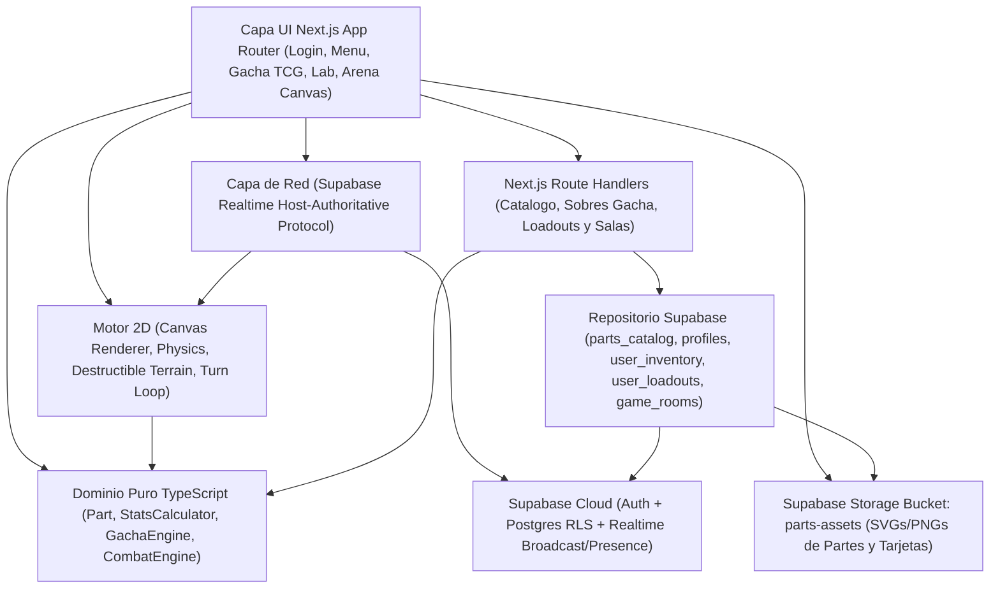
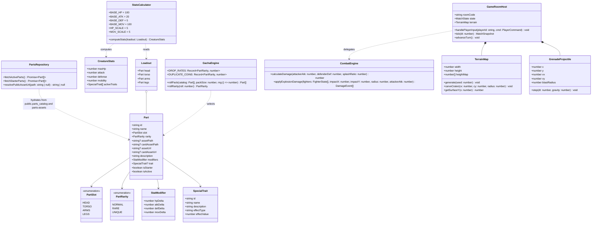
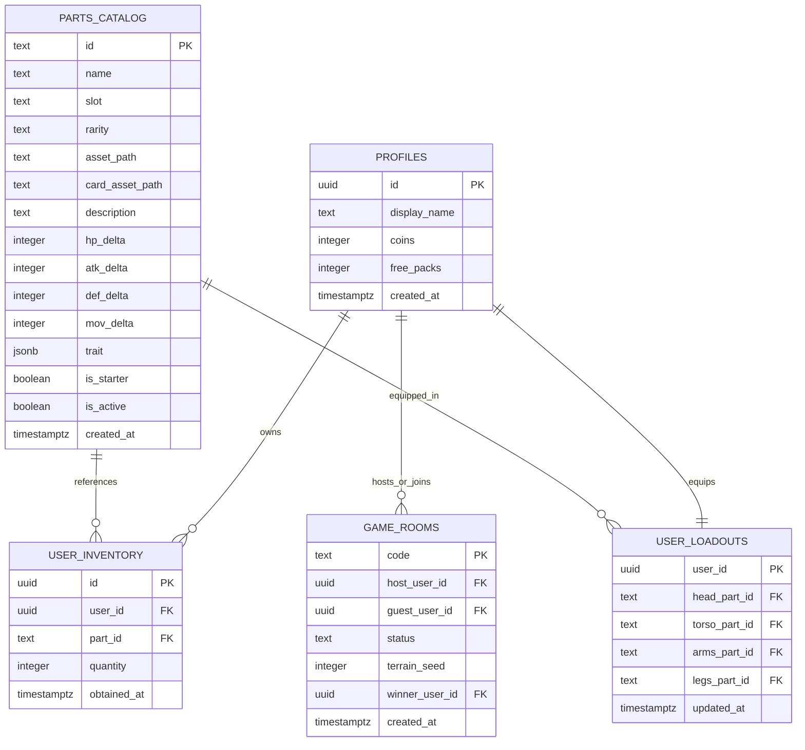
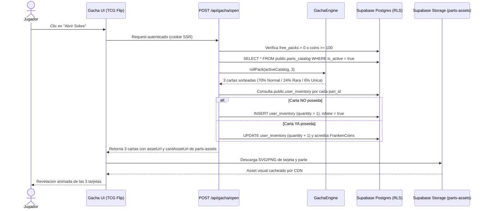
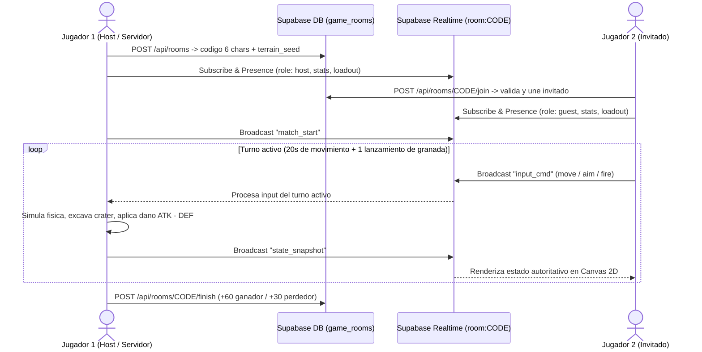
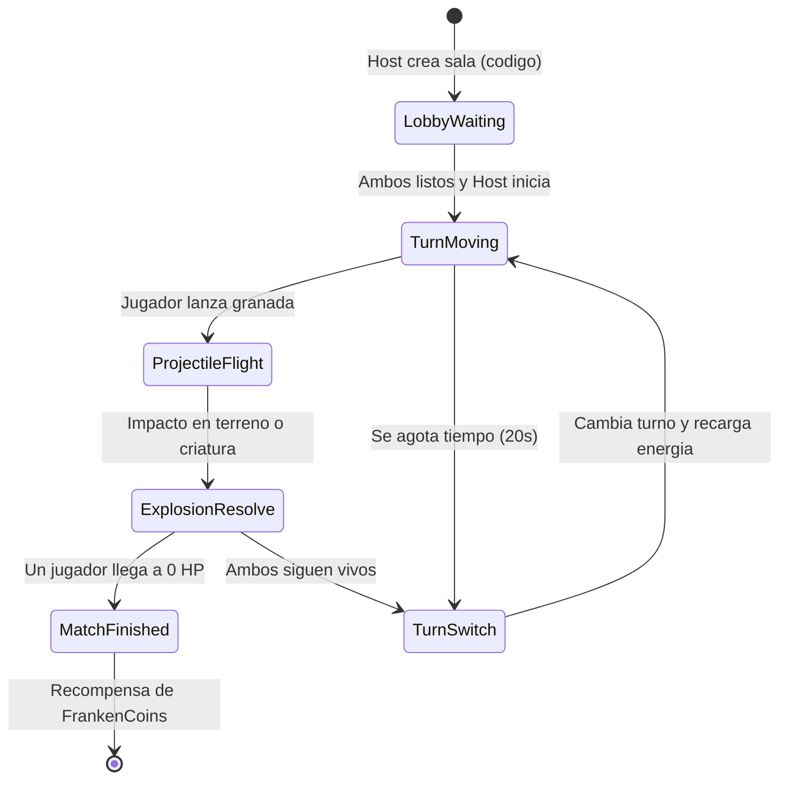

# 02. Arquitectura, Diagramas UML y Especificación de Base de Datos

## 1. Arquitectura en Capas (Modularidad Extrema)

El sistema separa el dominio puro de juego de Next.js y Supabase para facilitar pruebas unitarias, lectura académica y extensión futura.



---

## 2. Diagrama de Clases UML



---

## 3. Diagrama Entidad-Relación (Supabase Postgres + RLS)



---

## 4. Diagramas de Secuencia y Estados

### A. Apertura de Sobre Gacha (Inventario + Bucket `parts-assets`)



### B. Partida Multijugador Host-Autoritativo por Código de Sala



### C. Máquina de Estados de la Partida



---

## 5. Guía de Extensibilidad: Tabla `public.parts_catalog` y Bucket `parts-assets`

### Tabla que se modifica para agregar nuevas piezas: `public.parts_catalog`

Para agregar una nueva pieza (`normal`, `rare` o `unique`) al juego **no se modifica código fuente**:

1. **(Opcional) Sube la imagen PNG o SVG** al bucket público **`parts-assets`** en Supabase Storage:
   - Ruta recomendada para la parte: `parts/<slot>/<id>.svg` (o `.png`).
   - Ruta recomendada si la tarjeta tiene arte distinto: `cards/custom/<id>.png` (o `.svg`).
   - Si no subes imagen aún, deja `asset_path = NULL` y la interfaz mostrará automáticamente una ficha geométrica descriptiva.
2. **Inserta la fila en `public.parts_catalog`** respetando los rangos de balance por rareza:
   - `normal`: deltas entre `-2` y `+2` (`trait = NULL`).
   - `rare`: deltas entre `-3` y `+3` (`trait = NULL`).
   - `unique`: deltas entre `-4` y `+4` + objeto JSONB `trait` obligatorio.

#### Ejemplo SQL listo para insertar una nueva pieza rara o única

```sql
INSERT INTO public.parts_catalog (
  id,
  name,
  slot,
  rarity,
  asset_path,
  card_asset_path,
  description,
  hp_delta,
  atk_delta,
  def_delta,
  mov_delta,
  trait,
  is_starter,
  is_active
) VALUES (
  'arms_plasma_claw',
  'Garra de Plasma',
  'arms',
  'unique',
  'parts/arms/arms_plasma_claw.png',
  NULL,
  'Lanzador experimental de alta energia que sacrifica blindaje por alcance explosivo.',
  0,
  4,
  -1,
  0,
  '{
    "id": "wide_blast",
    "name": "Onda de Choque",
    "description": "Aumenta el radio de explosion de la granada en 15%.",
    "effectType": "blast_radius_pct",
    "effectValue": 15
  }'::jsonb,
  false,
  true
);
```

### Número promedio recomendado de piezas para versión completa
- **MVP actual:** 12 piezas (4 slots × 3 variantes: 1 Normal starter, 1 Rara, 1 Única).
- **Versión comercial / completa recomendada:** **24 a 36 piezas** (6 a 9 variantes por slot: 3 Normales, 2–3 Raras y 1–3 Únicas por cada parte del cuerpo) para sostener la rejugabilidad del Gacha sin diluir demasiado las piezas iniciales.
